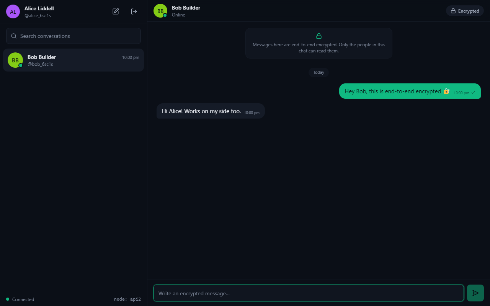
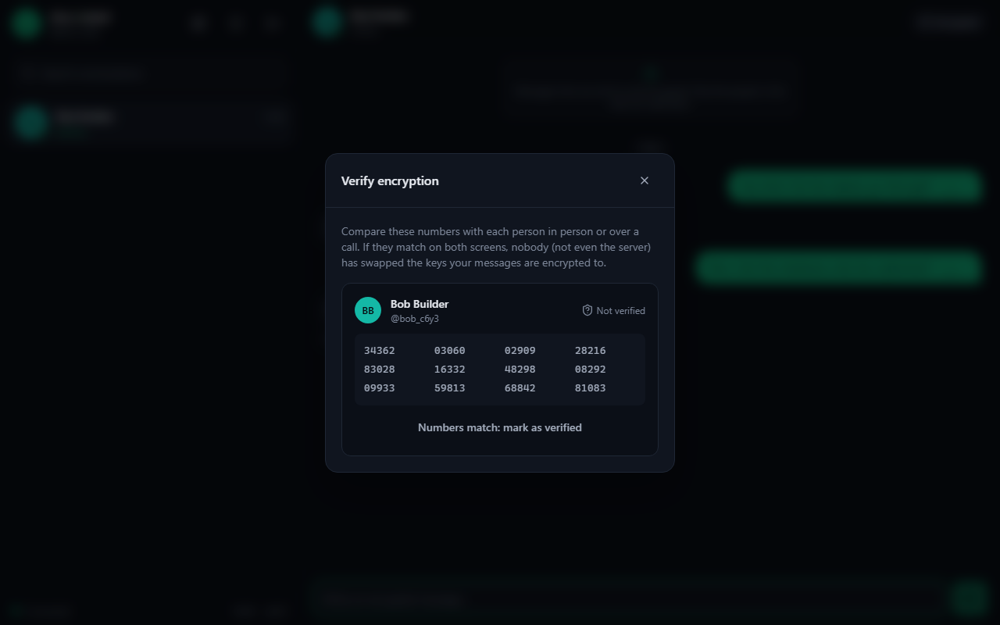
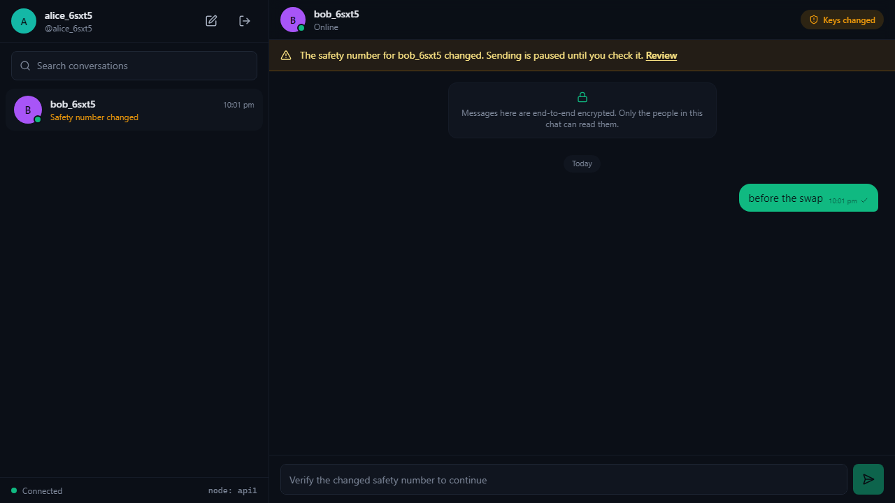
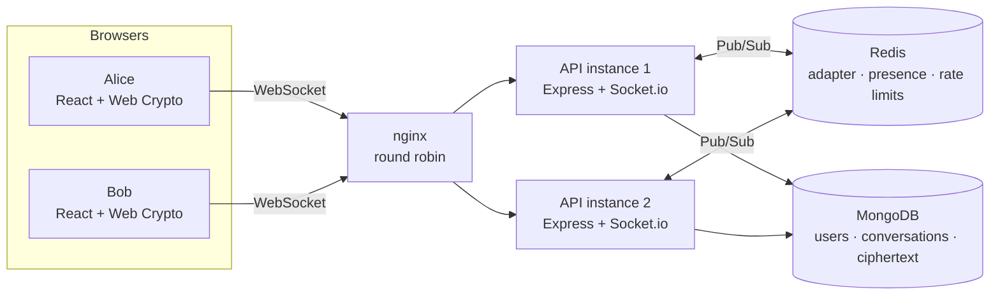

# EchoCrypt

**End-to-end encrypted real-time chat. Messages are encrypted in the browser; the server only ever stores and relays ciphertext.**

Socket.io for real-time delivery, MongoDB for ciphertext-only storage, and Redis Pub/Sub so the server can run as several instances behind a load balancer.



<p>
  
  
</p>

## Features

- **End-to-end encryption** for direct chats and groups (up to 32 members), using only the browser's Web Crypto API.
- **Zero-knowledge accounts.** The password never leaves the browser. Private keys are stored on the server only in encrypted form, so you can sign in on another device and still read your history.
- **Signed messages.** Every message is ECDSA-signed by its sender, so neither the server nor another member can forge or alter one.
- **Safety numbers and key-change detection.** Compare a 60-digit number to rule out a man-in-the-middle. If the server ever presents a different key for a contact, the chat shows a warning and sending pauses until you check it.
- **Real time:** live delivery, typing indicators, online presence, unread counts, and catch-up after reconnecting.
- **Horizontally scalable.** Run any number of API instances. Socket.io's Redis adapter carries events between them, and presence and rate limits live in Redis.
- **Reliable sending:** optimistic UI, idempotent resends (the same envelope is never stored twice), and retry on failure.
- Responsive layout, from phone to desktop.

## How the encryption works

All of this runs in [`packages/crypto`](packages/crypto/src/index.ts), a dependency-free module that uses Web Crypto in both the browser and Node.

```
Account
  password ──PBKDF2-SHA256 (600k)──▶ master ──HKDF──▶ authKey   → sent to server, hashed again with scrypt
                                              └─HKDF──▶ wrapKey   → never leaves the browser

Identity (generated in the browser at sign-up)
  ECDH P-256 key pair   (key agreement)
  ECDSA P-256 key pair  (signatures)
  private halves ──AES-256-GCM(wrapKey)──▶ uploaded, so other devices can unlock them with the password

Message
  K   = random 256-bit key, used once
  C   = AES-256-GCM(K, pad(plaintext), AAD = conversation | sender | clientId)
  for each member m (including the sender):
      e      = fresh ephemeral ECDH key pair
      KEK_m  = HKDF(ECDH(e, m.publicKey), info = conversation | clientId | m | e.pub)
      wrap_m = AES-256-GCM(KEK_m, K)
  sig = ECDSA-SHA256(sender, every field above)
  envelope = { C, iv, [ {m, e.pub, wrap_m} … ], sig }   ← all the server receives and stores
```

On receipt, the client **verifies the signature before decrypting**. Any tampering with the ciphertext, the key list, the conversation or the sender makes the message fail, and it is shown as unverifiable, never as text. Plaintext is padded to 128-byte blocks, so the ciphertext length doesn't reveal the exact message length.

### What the server can and cannot see

| The server sees | The server never sees |
| --- | --- |
| Usernames, display names, group names | Message contents |
| Who is in which conversation, and when messages are sent | Your password |
| Public keys; *encrypted* private keys | Your private keys, or the key that unlocks them |
| Ciphertext size (rounded to 128 bytes) | Exact message length |

The full threat model, including what EchoCrypt does **not** protect against, is in [SECURITY.md](SECURITY.md).

## Architecture



- Clients use the WebSocket transport only, so the load balancer needs **no sticky sessions**.
- Every emit goes to per-user rooms (`user:<id>`). The Redis adapter publishes it, and whichever instance holds that user's sockets delivers it.
- **Presence** is a Redis sorted set of live sockets per user, scored by expiry. Each instance refreshes its own sockets, so if an instance crashes, its users go offline when the entries expire, not never.
- **Rate limits** (login, sign-up, messages, typing) are Redis counters shared across all instances.
- Before storing an envelope, the server checks that the sender is a member, that the signature verifies against the sender's registered key, and that the envelope carries a key for **exactly** the current members. It cannot decrypt anything.

## Verified

| Check | What it covers | Result |
| --- | --- | --- |
| `npm run test:crypto` | Round trips, tamper detection on every signed field, forged senders, non-members, key separation, safety numbers | 17 / 17 pass |
| `npm run test:server` | Two server instances sharing Mongo + Redis: auth, cross-instance delivery, ciphertext-only storage, idempotency, rejection of forged or incomplete envelopes, history and pagination, group membership, presence and typing across instances, rate limits | 15 / 15 pass |
| `npm run scale-check` | Real Docker stack: load balancer reaches both instances; users on different instances exchange 50 messages | 50 / 50 delivered and decrypted; p50 ≈ 9 ms send→receive (one machine, Docker Desktop) |
| `e2e/` (Playwright) | Real browsers: sign-up, direct and group chat, typing, safety numbers, reload, new-device sign-in, wrong password, server-side key swap | 10 / 10 checks pass |

CI runs all four on every push ([workflow](.github/workflows/ci.yml)). The latency figure is from a single local run; it is not a load test.

## Quick start

Requires Docker.

```bash
docker compose up -d --build
```

Open **http://localhost:8090**, create two accounts (for example in a normal and a private window), and start chatting. The footer shows which API instance your connection landed on.

```bash
# Verify horizontal scaling against the running stack
npm ci && npm run build -w @echocrypt/crypto
npm run scale-check

# Browser end-to-end tests
cd e2e && npm install && npx playwright install chromium && npm test
```

Set your own `JWT_SECRET` (32+ random characters, the same on every instance) and `COOKIE_SECURE=true` for anything beyond local use. Web Crypto requires a secure context: `https://` or `localhost`.

## Deploy

The repo includes a [Render Blueprint](render.yaml): one Docker web service plus a Key Value (Redis) instance, with MongoDB on Atlas. All three have free tiers. Step-by-step: [docs/deploy-render.md](docs/deploy-render.md).

Any host works if it supports WebSockets and HTTPS. Set `NODE_ENV=production`, `MONGO_URL`, `REDIS_URL`, `JWT_SECRET`, `COOKIE_SECURE=true`, and `TRUST_PROXY` (the number of proxies in front of the app).

## Local development

```bash
npm ci
cp .env.example .env              # point MONGO_URL / REDIS_URL at your databases
npm run dev:server                # API on :4000
npm run dev:client                # Vite on :5174, proxies /api and /socket.io
```

Tests need MongoDB and Redis. By default they use `localhost:27018` and `localhost:6380`:

```bash
docker run -d -p 27018:27017 mongo:7
docker run -d -p 6380:6379 redis:7-alpine
npm test
```

## Project structure

```
packages/crypto/   Isomorphic E2E crypto (Web Crypto only) + unit tests
server/            Express + Socket.io API, Mongoose models, Redis adapter, presence, rate limits
  src/socket/      Real-time events: send (validate → verify → store → fan out), typing, presence
  test/            Integration tests running two instances side by side
client/            React + TypeScript + Tailwind; keys held as non-extractable CryptoKeys in IndexedDB
scripts/           scale-check: cross-instance delivery against a live deployment
e2e/               Playwright browser tests
deploy/            nginx load-balancer config
```

## Limitations

These are deliberate scope limits, stated plainly:

- **No forward secrecy between sessions.** Message keys are wrapped to each member's long-term key (with a fresh ephemeral key per message and recipient). If a member's private key and password were both compromised, their past messages could be decrypted. A Double Ratchet (as in Signal) would fix this, and it is the natural next step.
- **Trust on first use.** Key-change detection protects you after the first contact. To rule out a man-in-the-middle at first contact, compare safety numbers.
- **The server delivers the JavaScript.** As with any web-based E2EE app, a compromised server could serve modified client code. Native apps or reproducible builds address this.
- **Metadata is visible** to the server (see the table above).
- **No password recovery.** Losing the password means losing the keys, by design.
- Sessions are 7-day JWTs in an `HttpOnly`, `SameSite=Strict` cookie. Signing out clears the cookie and local keys, but a stolen token stays valid until it expires.
- Text messages only; no attachments yet.

## Tech stack

**Client:** React 18, TypeScript, Vite, Tailwind CSS 4, Zustand, Socket.io client, Web Crypto API, IndexedDB
**Server:** Node.js, Express, Socket.io 4, `@socket.io/redis-adapter`, ioredis, Mongoose (MongoDB 7), Zod, Helmet, Pino, JWT
**Infra and testing:** Docker, Docker Compose, nginx, GitHub Actions, Vitest, Playwright

## License

[MIT](LICENSE) © Sarvesh Raam T K
